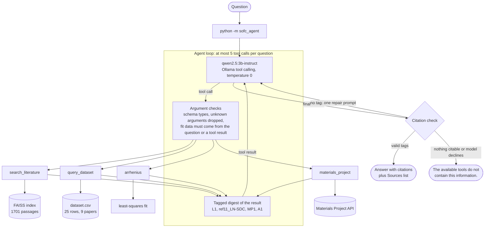

# SOFC Research Agent

A small research agent for **solid oxide fuel cell (SOFC) materials** that runs on a laptop,
for free. A local 3-billion-parameter model (`qwen2.5:3b-instruct`, served by
[Ollama](https://ollama.com)) reads a question, decides which of four tools to call, and is
held to answering **only from what the tools return**. Every citation in an answer is checked
against the tool results and expanded to the paper and page, the dataset `paper_id`, the
Materials Project entry or the Arrhenius fit it came from. When the tools return nothing
citable, the agent says so instead of guessing. The evaluation below shows where a 3B model
still slips past these checks.

A real answer from the evaluation run (question q06; 26 s on a laptop CPU):

```text
$ python -m sofc_agent "Which Sm-doped ceria-carbonate composite in the dataset has the highest conductivity at 600 C, and what is the value?"

The Sm-doped ceria-carbonate composite with the highest conductivity at 600 C is LN-SDC
((Li/Na)2CO3-SDC binary carbonate) with a conductivity value of 0.31 S/cm. [ref11_LN-SDC]

Sources:
- ref11_LN-SDC: Ali, Raza et al. 2018, ACS Appl. Mater. Interfaces (DOI 10.1021/acsami.7b17010) (extracted dataset)

Tools called:
  query_dataset(temperature_C=600, carbonate='binary', dopant='Sm') -> 3 of 25 rows match ...
```

(The answer is right, but the filter is not quite: the question asked about any carbonate,
and the model narrowed it to binary carbonates. It worked here only because the best
composite happens to be a binary one. See [Limitations](#limitations-of-a-3b-local-model).)

**Evaluation at a glance** (24 questions, one run, details [below](#evaluation)): the model
picked the right tool for **20/20** single-tool questions and both tools for **3/4**
two-tool questions; **19/19** answers cite a tool result; **13/20** answerable questions were
answered correctly and **4/4** unanswerable ones were declined; median **24 s** per question
on a laptop CPU.

---

## The four tools

| Tool | Answers questions like | Backed by |
| --- | --- | --- |
| `search_literature` | "What mechanism explains the high conductivity of ceria-carbonate composites?" | FAISS index (1701 passages, all-MiniLM-L6-v2) over the author's SOFC paper corpus, reused from [sofc-literature-rag](https://github.com/nawalasghar/sofc-literature-rag) |
| `query_dataset` | "Which Sm-doped carbonate composite conducts best at 600 C?" | `dataset.csv` from [ceria-carbonate-llm-dataset](https://github.com/nawalasghar/ceria-carbonate-llm-dataset): 25 compositions (20 with measured values) extracted from 9 papers, every row carrying its `paper_id` |
| `arrhenius` | "What is Ea for 0.02, 0.05 and 0.11 S/cm at 773, 823 and 873 K?" | least-squares fit of ln(σT) or ln(σ) against 1/T, standard library only |
| `materials_project` | "Is Na2CO3 stable? What is the band gap of CeO2?" | the free [Materials Project](https://materialsproject.org) API: energy above the convex hull, DFT band gap, space group |

Each tool is a plain Python function with a JSON schema (`sofc_agent/tools/`) and works on
its own, without the model. The tools accept what a small model actually sends: element
names or composition names for the dopant ("samarium", "SDC", "LN-SDC"), carbonate systems
in any spelling ("Na2CO3-K2CO3", "(Li/Na)2CO3", "sodium carbonate"), temperatures in kelvin
or as ranges, and conductivities in scientific notation with units ("5.2 × 10⁻³ S cm⁻¹").

---

## Architecture



### How a 3B model is kept honest

A small model follows instructions loosely, so the loop does not rely on the prompt alone.
Each guard below exists because the model was seen doing the thing it prevents, either
during development or in review.

| Guard | What it stops |
| --- | --- |
| **Source tags.** Every passage, dataset paper, Materials Project entry and fit in a tool result carries a short tag (`[L1]`, `[ref11_LN-SDC]`, `[MP1]`, `[A1]`). Valid tags in the answer are expanded into full citations (title and page, `paper_id`, material id) and listed under the answer. | A 3B model cannot copy long titles reliably, but it copies short tags well, and tags can be checked. |
| **Invented tags are removed.** A tag the model was never given becomes `[unverified source]` and is counted. | Citations that look right but point at nothing. In the evaluation this caught one invented tag (`[A1]`) used six times in one answer (q04). |
| **No tool, no answer.** A reply without a tool call gets one nudge, then the standard not-found sentence. | Answering from the model's own memory (2 of 24 first replies had no tool call; after the nudge both called the right tool). |
| **Nothing citable, no answer.** If every tool came back empty (no rows, no Materials Project entry, no relevant passage), the answer is the not-found sentence, whatever the model wrote. | Filling a gap with a plausible number. |
| **Relevance gates.** No passage reaches the model unless the best one scores ≥ 0.50, and then only passages ≥ 0.40. | Off-topic questions answered from loosely related passages. |
| **Fit data must be traceable.** The agent refuses an `arrhenius` call whose temperatures or conductivities do not appear in the question, a relevant passage, a dataset row or an earlier fit. (The tool itself, called directly from Python, fits whatever it is given.) It reads units the way they are written (a number followed by "mol%" is not a conductivity). Refusals never repeat the rejected numbers, so a retry cannot pass off the model's own numbers as sourced. | A model inventing a conductivity series and citing the fit. Seen in development; review found three ways around the first version, all closed. |
| **Units follow the question.** If every temperature was written in kelvin and the model omits `temperature_unit`, the fit uses kelvin and says so. | A cited but wrong Ea (1.86 instead of 1.06 eV). |
| **Schema-shaped arguments.** Arguments not in the schema are dropped; `["CeO2"]` and echoed schemas are unwrapped; a query with several filters that returns nothing reports how many rows each filter matches on its own. | `limit=1` silently cutting the data to one (wrong) row; crashes on odd argument shapes; dead ends. |
| **Neutral digests.** Dataset rows come first; "highest value" statistics are labelled and placed after them. | The model attributing the best row's value to whichever composition was asked about. |
| **One repair round.** An answer with no valid tag gets one request to rewrite with tags; if it still has none, it is shown under an *Unverified* warning. | Uncited prose passing as a grounded answer. |
| **Number check.** Numbers in the answer that do not round from any number in the tool output or question are reported. | A heuristic flag for hallucinated values; it does not change the answer. |

---

## Run it locally

Requirements: Python 3.10+, [Ollama](https://ollama.com), about 2 GB of disk for the model
and the embedding model. No GPU is needed; everything here was developed and evaluated on a
4-core laptop CPU.

```powershell
# 1. the local model
ollama pull qwen2.5:3b-instruct

# 2. Python dependencies
python -m venv .venv
.venv\Scripts\python.exe -m pip install -r requirements.txt

# 3. a free Materials Project key (https://profile.materialsproject.org), kept out of git
copy .env.example .env      # then set MP_API_KEY=... in .env

# 4. the dataset, and config.yaml pointed at it and at the literature index
git clone https://github.com/nawalasghar/ceria-carbonate-llm-dataset
#    paths.dataset_csv -> ceria-carbonate-llm-dataset/results/dataset.csv
#    paths.rag_root    -> folder containing index/chunks.faiss and index/chunks.jsonl
```

The dataset is public in
[ceria-carbonate-llm-dataset](https://github.com/nawalasghar/ceria-carbonate-llm-dataset).
The FAISS index is built by
[sofc-literature-rag](https://github.com/nawalasghar/sofc-literature-rag) from your own
copies of the papers. It is not redistributed here, because it is derived from papers under
publishers' copyright. Without the index, `search_literature` returns a clear
`index_unavailable` error. Without `MP_API_KEY`, `materials_project` returns
`missing_api_key`. The other tools keep working in both cases.

Ask a question:

```powershell
python -m sofc_agent "Is CeO2 thermodynamically stable according to the Materials Project?"
python -m sofc_agent --trace "Fit Ea for 0.02, 0.05 and 0.11 S/cm at 773, 823 and 873 K"
python -m sofc_agent --json "What activation energy is reported for the LNK-SDC composite?"
```

| Flag | Effect |
| --- | --- |
| `--trace` | also print the stop reason, token counts and the model's raw reply |
| `--json` | print the full result (tool calls, arguments, citations, timings) as JSON |
| `--model TAG` | use another Ollama model |
| `--max-tool-calls N` | change the per-question tool budget (default 5) |

Use the tools directly, without the model:

```python
from sofc_agent.tools import query_dataset, arrhenius, materials_project, search_literature

query_dataset(dopant="Sm", carbonate="any", temperature_C=600)["summary"]
arrhenius(temperatures="773, 823, 873 K", conductivities=[0.02, 0.05, 0.11])["activation_energy_eV"]
```

---

## Evaluation

`eval/questions.csv` holds 24 questions, each written for one expected tool:

* **20 single-tool questions, 5 per tool.** Four per tool are answerable. The fifth cannot be answered from that tool and tests whether the agent declines instead of guessing: a gold-nanoparticle question for the SOFC corpus, Gd-doped ceria (absent from the dataset), a one-point Arrhenius fit, and a doped formula the Materials Project does not index.
* **4 two-tool questions**, one for each pairing that makes sense: dataset + Materials Project, dataset + literature, Arrhenius + dataset, and Materials Project + literature.

Reference answers were computed from the tools themselves, not written from memory.
Two Arrhenius questions are deliberate traps: temperatures given in kelvin (q12), and a
request for the ln σ convention (q13). A wrong unit or convention gives a measurably
different Ea.

For each question the runner records the tools chosen, whether they match the expected
tools, whether the answer cites a tool result, whether it is correct, and the time taken.
It writes each result to disk as soon as the question finishes, so a crash loses at most
the question in progress, and a rerun resumes where it stopped.

```powershell
python eval/run_eval.py                 # run; resumes after a crash
python eval/run_eval.py --summary-only  # rebuild eval/summary.md from eval/results.csv
```

### Results

One run on an Intel i5-1145G7 (4 cores, CPU only), Ollama 0.34.4, `qwen2.5:3b-instruct`
(Q4_K_M), temperature 0, seed 42, at most 5 tool calls per question. The full per-question
table is in [`eval/summary.md`](eval/summary.md); answers are in `eval/results.csv`, and
every tool call with its arguments is in `eval/traces.jsonl`.

| Metric | Result |
| --- | --- |
| Expected tool called, single-tool questions | **20/20 (100%)**, always the first tool called, never an extra one |
| Both expected tools called, two-tool questions | **3/4 (75%)** |
| Answer cites a tool result (answered questions) | **19/19 (100%)**, all without the repair prompt |
| Answer correct, answerable questions | **13/20 (65%)** |
| Correctly declined, unanswerable questions | **4/4 (100%)** |
| Wrongly declined, answerable questions | 1/20 (5%) |
| Invented citation tags caught and removed | one tag (`[A1]`) used six times, in q04 |
| Answers with a number not found in any tool output | 1/19 (5%) |
| Time per question, median / mean | **23.8 s / about 29 s** (see the note on timing) |

| Expected tool | Tool matched | Correct | Mean time |
| --- | --- | --- | --- |
| `search_literature` | 5/5 | 4/5 | 41.4 s |
| `query_dataset` | 5/5 | 3/5 | 21.8 s |
| `arrhenius` | 5/5 | 5/5 | 15.2 s |
| `materials_project` | 5/5 | 5/5 | 17.1 s |
| two-tool questions | 3/4 (both tools) | 0/4 | about 55 s |

**What went wrong.** Seven answers were marked incorrect. None is a bug in the harness: six
show a weakness of the model, and q04 is partly a retrieval miss.

| Question | What happened |
| --- | --- |
| q04 (literature) | The search did not retrieve the passage that says the shell blocks electrons (it was retrieved for q24). The answer paraphrased what it did get ("a protective layer") and cited one tag it was never given, `[A1]`, six times (all caught). |
| q07 (dataset) | Reported only the highest of the three Al-doped conductivities. |
| q09 (dataset) | Filtered with the wrong carbonate, then reported another composition's peak power (980 mW/cm², CSDC) as NK-CDC's, **with a valid citation to the wrong row**. |
| q21 (dataset + MP) | Read "N-SDC" as "LN-SDC" and combined it with a Na2CO3 filter, so no row matched. The tool listed how many rows each filter matched on its own, but the model did not retry. It then wrongly said the dataset has no N-SDC value at 600 C and answered only the Materials Project half. |
| q22 (dataset + literature) | Never searched the literature and answered the "why" half from memory; the dataset half was right and cited. |
| q23 (Arrhenius + dataset) | Mixed up the arguments of a second `arrhenius` call and a `query_dataset` call in the same turn, so the dataset query ran unfiltered over all 25 rows. The fit was right (0.630 eV), but the answer reported 0.238 eV, **a value from a different dataset row**, and gave N-SDC's 0.53 eV as LN-SDC's. |
| q24 (MP + literature) | Both tools returned relevant results; the model declined the whole question. |

All four declines were correct, but they say more about the guards than about the model. In
every case the tools left nothing to cite: an empty dataset query, a failed one-point fit, a
formula with no Materials Project entry, and passages below the relevance gate for the
gold-nanoparticle question. The not-found answer therefore did not depend on the model,
although its own reply also declined in all four cases.

**How "correct" is decided.** It is an automatic check, not a human grade. For numbers, the
answer must report the reference value to its own precision (5.0574 matches "5.06" or "5.1",
not "5" or "5.03"). Composition names must match as whole words ("LN-SDC" is not found
inside "LNK-SDC"). Stability claims fail on "metastable" or "not on the convex hull" in the
sentence about that compound. On two-tool questions that include the literature, the answer
must also cite a passage. A decline passes only if the answer claims no value of its own.
The checks for the explanatory literature questions are the most lenient, and a pass there
means the answer is on topic and cited, not that it is complete.

**A note on timing.** The raw run in `eval/summary.md` shows q23 at 2673 s and a mean of
136 s. The Windows event log shows the laptop entered Modern Standby at 17:03:18, shortly after
q23 started, and stayed there until 17:46:11, apart from a momentary wake at 17:03:42. That
is 2573 s. Without it, q23 took about 100 s, and the figures above use that value (mean
29.1 s, total 11.6 min for 24 questions). The median is unaffected. The adjustment is an
estimate: the machine also entered standby during q24, which still finished in a normal
56 s, so standby does not always pause the work. To reproduce the timings, keep the machine
awake during a run.

---

## Limitations of a 3B local model

* **A valid citation is not a correct answer.** The citation check proves that every tag
  points at something a tool returned, not that the sentence matches it. Dataset tags name a
  paper, not a row. q09 and q23 cite real papers but attach values to the wrong composition:
  q09 gives CSDC's 980 mW/cm² as NK-CDC's, and q23 gives N-SDC's 0.53 eV as LN-SDC's. The
  number check catches invented numbers, but not a real number placed in the wrong sentence.
* **Tool arguments are the weak point.** Tool *choice* was perfect on single-tool questions,
  but 5 of the 8 dataset queries had wrong or needlessly narrow arguments:
  * a misread composition name (q21);
  * the wrong carbonate (q09);
  * a carbonate filter the question never asked for (q06 and q10);
  * arguments meant for `arrhenius`, which left the query unfiltered (q23).

  The tools now accept many spellings, and they report how many rows each filter matches when
  a combination returns nothing. Even so, in q21 the model did not retry.
* **Two-part questions are hard.** The model tends to answer one half, answer the other from
  memory (q22), or decline both (q24). None of the four two-tool questions was fully
  correct.
* **It does not always call a tool first.** 2 of 24 questions got a first reply with no tool
  call. After the nudge, both called the right tool. Without the loop's checks, replies like
  these could become uncited guesses.
* **Relevance is approximate.** Embedding similarity cannot fully separate SOFC questions
  from nearby materials-science ones. On 24 held-out queries, on-topic questions scored
  0.565–0.766 and near-domain ones (batteries, PEM fuel cells, TiO₂ photocatalysis) scored
  0.298–0.606. The 0.50 gate stops 7 of those 12 near-domain queries; the other 5 rely on the
  model to decline.
* **Not reproducible to the bit.** Temperature 0 and a fixed seed still give run-to-run
  differences on llama.cpp (KV-cache reuse changes floating-point results), so a rerun can
  choose different tool arguments. The numbers above are from a single run of 24 questions.
  They show the kinds of failure to expect; they are not a precise accuracy estimate.
* **Speed.** On a 4-core CPU a question takes 8–100 s, with a median of 24 s. Literature
  answers are the slowest, mainly because they are the longest (188 generated tokens on
  average, against 99–119 for the other tools); their prompts are also about 20% longer.
* **The data sets the ceiling.** The dataset has 25 rows (20 with measurements) from 9
  papers. Materials Project band gaps are DFT (GGA) values, which underestimate measured gaps
  (2.0 eV for CeO₂ against roughly 3 eV measured). The tool labels them as DFT values, but
  the model's answers usually drop the label: in the evaluation only one of five answers
  mentioned it.

---

## Project layout

```
config.yaml                 paths, model settings, guard thresholds
.env.example                template for the Materials Project key (.env is gitignored)
sofc_agent/
  agent.py                  the tool-calling loop, digests, citation and grounding checks
  cli.py, __main__.py       python -m sofc_agent "question"
  numbers.py                one parser for numbers, units and rounding, shared by all parts
  evaluation.py             scoring and summary for the evaluation
  config.py                 config.yaml and .env loading
  tools/                    the four tools and their JSON schemas
eval/
  questions.csv             24 questions with expected tools, keyword checks and references
  run_eval.py               crash-safe, resumable evaluation runner
  results.csv, summary.md   results of the run reported above (raw, unedited)
  traces.jsonl              every tool call, argument and answer from that run
  run_meta.json             model, Ollama version and hardware of that run
scripts/test_tools.py       prints what each tool returns, without the model
tests/                      unit tests; the model is replaced by a scripted fake
```

## Tests

```powershell
python -m unittest discover -s tests -v
python scripts/test_tools.py --tool dataset
```

179 tests, about 10–30 s. They need `paths.dataset_csv` pointed at the dataset (see
[Run it locally](#run-it-locally)). Tests that need the literature index or an MP key skip
themselves when those are missing. The agent tests drive the loop with a scripted fake model, so every
guard is exercised deterministically without Ollama: the tool limit, nudge, repair, invented
tags, invented fit data, empty results, dropped arguments, text-embedded tool calls and
malformed replies. The evaluation tests kill a run mid-question and check that the rerun
resumes without repeating work. The guards were hardened over three review rounds, which
found 48 defects between them; each one is now pinned by a regression test.

## License

MIT, see [LICENSE](LICENSE).
